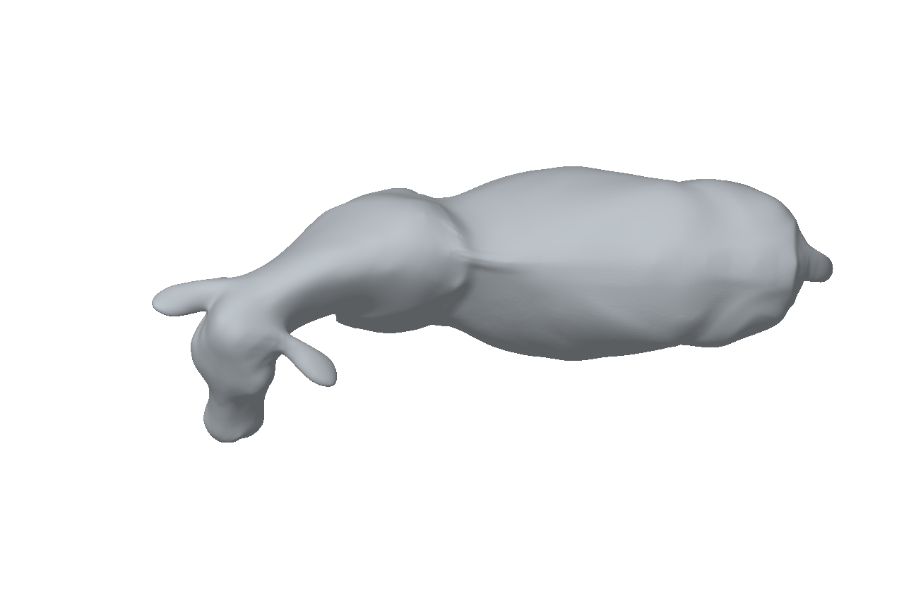
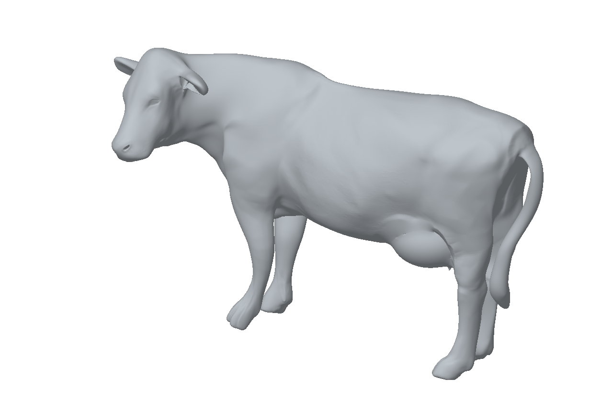
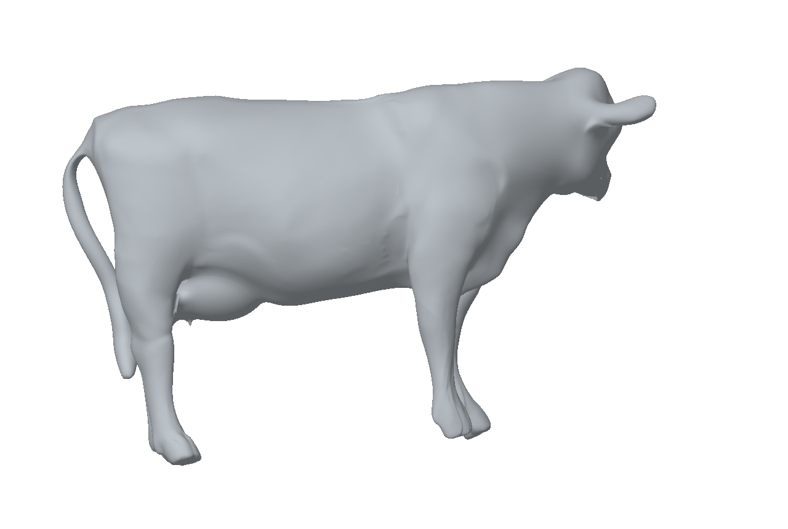

# Fine-Grained Cattle Reconstruction

**Single-view RGB-D research for cattle shape representation**

Project overview

## Overview

This project investigates three-dimensional cattle body reconstruction from a single RGB-D observation. The research aims to represent overall body shape and local surface structure, with potential applications in non-contact livestock phenotyping and digital animal modeling.

**Status: ongoing, unpublished research.** This repository currently provides a brief introduction, selected geometry previews, and general environment information.

## Geometry preview

  
   
  <em>Mesh preview from the input camera viewpoint.</em>

The following images show the same example geometry from additional viewpoints; they do not represent additional input images.

| Side view | Top view |
| :---: | :---: |
|  |  |
| **Oblique view** | **Opposite-side view** |
|  |  |

The side view presents the body outline, the top view shows the body-width profile, and the oblique view reveals spatial relationships among the torso and limbs. The opposite-side view displays the model surface outside the original viewing direction. These illustrations are qualitative previews; rendered hidden surfaces are not independent observations or validation of anatomical accuracy.

## General prerequisites

For calibrated RGB-D research, the basic input information consists of:

- An RGB image and its corresponding depth map.
- Camera intrinsics and a known spatial correspondence between RGB and depth.

## Public technology references

The following resources introduce relevant publicly available technologies. Project-specific adaptations and their integration remain unpublished.

| Technology | Public scope | Official resource |
| :--- | :--- | :--- |
| Ultralytics YOLO11 | Image-based detection, instance segmentation, and pose estimation | [Documentation](https://docs.ultralytics.com/models/yolo11/) |
| SMAL | Articulated parametric models of animal shape and pose | [Model website](https://smal.is.tue.mpg.de/) |
| TRELLIS.2 | Image-to-3D asset generation | [Microsoft repository](https://github.com/microsoft/TRELLIS.2) |
| PyTorch | Tensor computation and automatic differentiation | [Documentation](https://pytorch.org/get-started/locally/) |

## Environment guidance

These notes summarize public upstream requirements. Use a separate environment for each component and follow the documentation for the selected release.

| Component | Upstream environment guidance | Setup reference |
| :--- | :--- | :--- |
| TRELLIS.2 | Upstream-tested platform: Linux; Windows is supported via a community-maintained configuration using pre-built CUDA wheels and an automatic SDPA attention fallback. CUDA Toolkit 12.4 is recommended. The default setup uses PyTorch 2.6.0 with CUDA 12.4. | [Prerequisites and installation](https://github.com/microsoft/TRELLIS.2/blob/main/README.md) |
| Ultralytics | The quickstart lists Python >= 3.8 and PyTorch >= 1.8. Select a compatible PyTorch build before installing Ultralytics; individual releases may impose additional requirements. | [Installation guide](https://docs.ultralytics.com/quickstart/) |
| PyTorch / CUDA | Match the operating system, Python version, GPU driver, and CUDA-enabled PyTorch build using the official installation guidance. | [PyTorch](https://pytorch.org/get-started/locally/) / [NVIDIA CUDA](https://docs.nvidia.com/cuda/) |
| SMAL | Obtain model assets through the official site and follow the requirements of the chosen implementation and the model's own access and license terms. | [Model access](https://smal.is.tue.mpg.de/) |

These are component-level references; compatibility of a combined environment is not provided here. Third-party code and model assets retain their respective licenses.

## Availability

Publication information and any future public releases will be announced in this repository.

## License

See [LICENSE](LICENSE).
