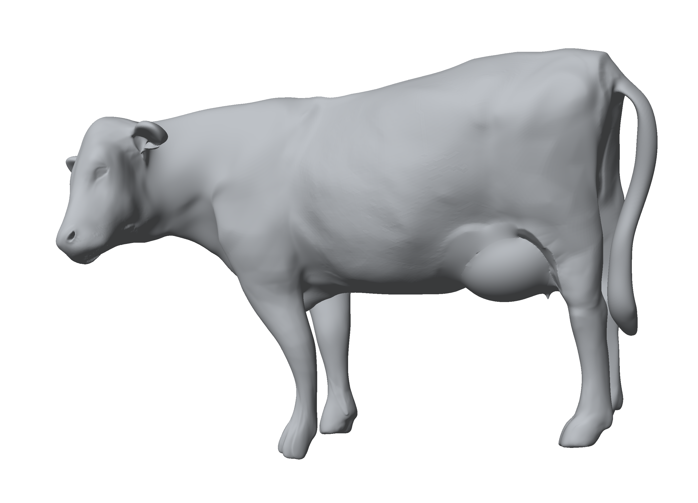
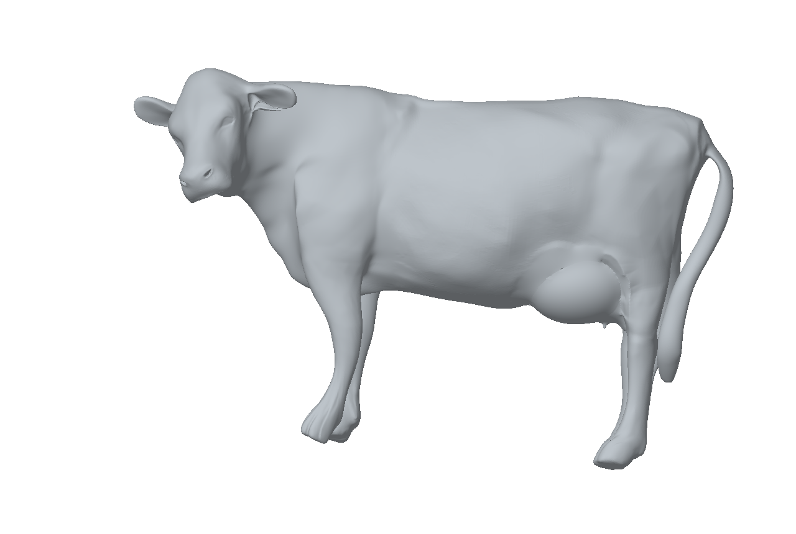

# Fine-Grained Cattle Reconstruction

**Single-view RGB-D research for cattle shape representation**

Project overview · Geometry preview · Environment notes

## Overview

This project investigates three-dimensional cattle body reconstruction from a single RGB-D observation. The research aims to represent overall body shape and local surface structure, with potential applications in non-contact livestock phenotyping and digital animal modeling.

**Status: ongoing, unpublished research.** This repository currently provides a brief introduction, selected geometry previews, and general environment information. Research code, datasets, model weights, methodological details, and quantitative experiments are not included in this public preview.

## Geometry preview

  
   
  <em>Mesh preview from the input camera viewpoint.</em>

The following images show the same example geometry from additional viewpoints; they do not represent additional input images.

| Side view | Top view |
| :---: | :---: |
|  |  |
| **Oblique view** | **Opposite-side view** |
|  |  |

The side view presents the body outline, the top view shows the body-width profile, and the oblique view reveals spatial relationships among the torso and limbs. The opposite-side view displays the model surface outside the original viewing direction. These illustrations are qualitative previews; rendered hidden surfaces are not independent observations or validation of anatomical accuracy.

## General prerequisites

For calibrated RGB-D research, the basic input information consists of:

- An RGB image and its corresponding depth map.
- Camera intrinsics and a known spatial correspondence between RGB and depth.
- Explicit depth units and a definition of invalid depth values.

## Reference development environment

| Component | Reference version |
| :--- | :--- |
| Operating system | Windows 11 |
| Python | 3.10.20 |
| PyTorch | 2.8.0 |
| PyTorch CUDA build | 12.8 (`cu128`) |

These versions describe a reference development environment, not a complete installation specification. GPU execution requires a compatible NVIDIA GPU and driver. Minimum hardware requirements and a complete reproducible environment are not specified in this preview.

Official setup resources:

- [Python downloads and documentation](https://www.python.org/downloads/)
- [PyTorch installation guide](https://pytorch.org/get-started/locally/)
- [NVIDIA CUDA documentation](https://docs.nvidia.com/cuda/)

## Availability

Publication information and any future public releases will be announced in this repository. No release date is committed at this stage.

## License

See [LICENSE](LICENSE).
